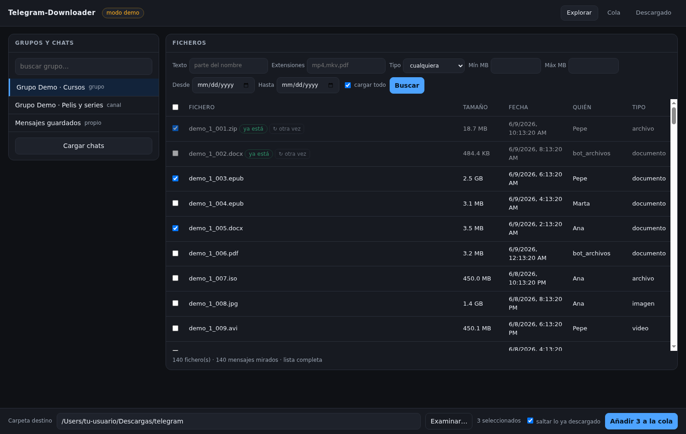
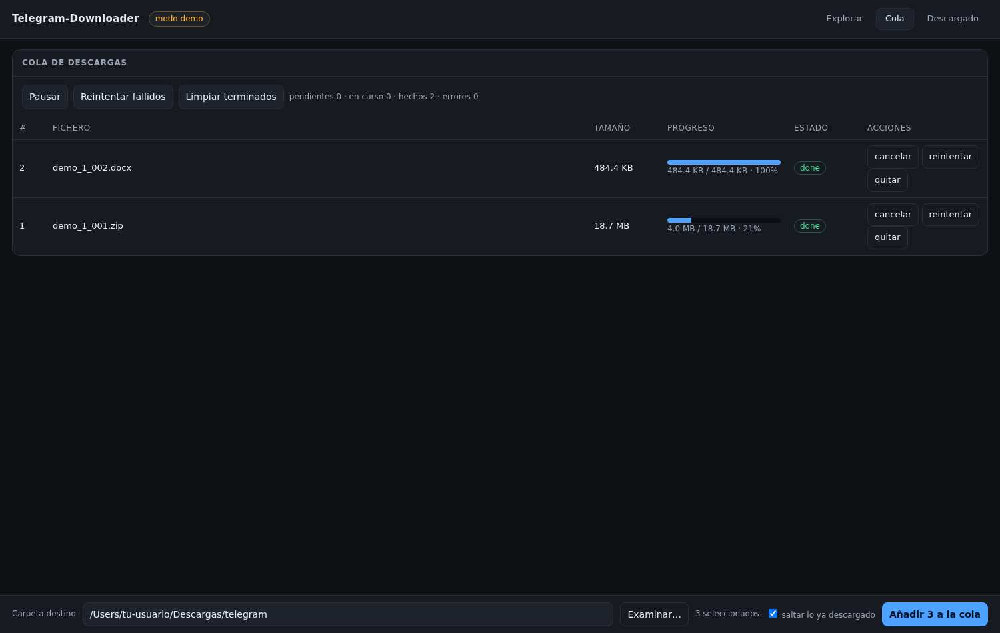

<div align="center">

# ⬇️ Telegram-Downloader

**Descarga por cola los archivos de un grupo de Telegram con tu propia cuenta y una interfaz web local.**
**Queue-based downloader for files in a Telegram group, using your own account and a local web UI.**

[](https://www.python.org/)
[](#-instalación)
[](requirements.txt)
[](LICENSE)

🇪🇸 **Español** · 🇬🇧 [**English**](#-english)



</div>

---

# 🇪🇸 Español

Lista los ficheros de un grupo de Telegram, marcas los que quieres, se encolan y se descargan donde tú
digas. Sin bots, sin servidores intermedios y sin subir nada a ningún sitio: habla **únicamente con
Telegram**, desde tu ordenador, con tu cuenta.

## ✨ Qué hace

- **Lista la lista completa de golpe**: vídeo, audio, documento, comprimidos/ISO… con filtros por texto,
  extensión, tipo, tamaño mín/máx y rango de fechas. Mientras carga te va contando cuántos lleva
  (y puedes pararlo con *Parar* si el grupo tiene una historia enorme).
- **Selección con casillas** y **cola de descargas**: de una en una, con barra de progreso, pausa,
  cancelar, reintentar y limpiar terminados.
- **Marca lo que ya tienes** («ya está») y te deja **volver a bajarlo** con un clic (`↻ otra vez`) sin
  crear copias duplicadas: se reemplaza donde corresponda.
- **Carpeta destino a tu gusto**, con el explorador de carpetas del sistema (en macOS, el diálogo
  nativo del Finder).
- **También sin interfaz**: `list`, `add`, `run`, `status` desde la consola, ideal para tareas
  programadas.
- **Modo demo** (`--demo`): pruebas toda la aplicación con datos falsos, sin tocar tu cuenta.

## 🔒 Qué **no** hace

- No sube ficheros, no envía mensajes, no publica y **no borra nada** del grupo.
- No usa bots ni servidores de terceros. No hay telemetría.
- No necesita permisos de administrador en el grupo: lee lo que tu cuenta ya puede ver.

## 📦 Instalación

Necesitas **Python 3.9 o superior**. No hace falta Docker, ni compiladores, ni permisos especiales.

```bash
git clone https://github.com/ambrosio-AI/Telegram-Downloader.git
cd Telegram-Downloader
./run.sh demo          # macOS / Linux: crea el entorno y abre la interfaz con datos de prueba
```

```bat
:: Windows
git clone https://github.com/ambrosio-AI/Telegram-Downloader.git
cd Telegram-Downloader
run.bat demo
```

Si prefieres hacerlo a mano:

```bash
python3 -m venv .venv
./.venv/bin/python -m pip install -r requirements.txt
./.venv/bin/python -m telegram_downloader serve --demo
```

## 🚀 Puesta en marcha (una sola vez, 5 minutos)

1. **Consigue tus claves**: entra en <https://my.telegram.org> con tu número, abre
   *API development tools*, crea una aplicación cualquiera y copia **api_id** y **api_hash**.
2. Copia la plantilla: `cp config.example.toml config.toml` y pega ahí los dos valores
   (o expórtalos como `TD_API_ID` y `TD_API_HASH`).
3. **Enlaza tu cuenta**:

   ```bash
   ./run.sh login --qr     # muestra un QR: móvil → Ajustes → Dispositivos → Enlazar dispositivo
   ./run.sh login          # alternativa: teléfono + código (+ contraseña de 2FA si la tienes)
   ```

   Todo se teclea en tu ordenador; la sesión se guarda en `data/tg.session`.
4. **Arranca la interfaz**: `./run.sh` → se abre en <http://127.0.0.1:8765>.
5. En la interfaz: *Cargar chats* → elige el grupo → filtra → marca ficheros → *Examinar…* para la
   carpeta → *Añadir a la cola*.

### 🖱️ Lanzadores de doble clic (macOS)

| Fichero | Para qué |
| --- | --- |
| `1 Enlazar con Telegram.command` | Enlaza tu cuenta (solo la primera vez): abre la config y muestra el QR |
| `2 Arrancar Telegram-Downloader.command` | Arranca la interfaz y abre el navegador |

Si macOS avisa de que el fichero «proviene de un desarrollador no identificado», haz **clic derecho →
Abrir** una sola vez.

## 🖥️ La interfaz

- **Explorar**: buscador de grupos/chats, filtros y la tabla de ficheros con casillas. La lista se
  carga entera; abajo verás `N fichero(s) · M mensajes mirados · lista completa`.
- **Cola**: estado de cada descarga, progreso, errores y acciones (cancelar, reintentar, quitar).
- **Descargado**: todo lo que ya has bajado, con su ruta y su tamaño.



## ⌨️ Línea de órdenes

```bash
./run.sh list  --chat -1001234567890 --min-mb 100 --ext mp4,mkv
./run.sh add   --chat -1001234567890 --dest /mnt/disco/pelis --min-mb 100 --ext mp4 --run
./run.sh run   --follow        # procesa la cola y se queda vigilando
./run.sh status
./run.sh selftest              # prueba interna completa en modo demo
```

El `--chat` es el identificador del grupo (los supergrupos empiezan por `-100`); lo ves en la interfaz
o al listar.

## ⚙️ Configuración (`config.toml`)

```toml
[telegram]
api_id = 0
api_hash = ""
session = "data/tg"        # telethon le añade .session

[downloads]
root = "./descargas"       # carpeta destino propuesta
subfolder_por_grupo = true # una subcarpeta por grupo
skip_existing = true       # saltar lo ya descargado (se puede desactivar desde la interfaz)
max_retries = 3

[server]
host = "127.0.0.1"         # solo tu máquina
port = 8765
```

## 🛡️ Seguridad y privacidad

- `data/tg.session` **es tu cuenta**: quien tenga ese fichero puede usarla como tú. No lo compartas ni
  lo subas a ningún sitio. Está en `.gitignore`.
- Para revocar el acceso: **Telegram → Ajustes → Dispositivos → terminar sesión**.
- La interfaz escucha **solo en `127.0.0.1`**. No la expongas a la red.
- `api_id`, `api_hash` y la sesión se quedan en tu ordenador; el programa solo habla con Telegram.

## 🧱 Límites de Telegram (no del programa)

- Hasta **2 GB** por fichero (**4 GB** con Telegram Premium).
- Si encolas muchos seguidos, Telegram puede pedir una espera temporal (*FloodWait*): el programa
  espera y reintenta solo.
- Las **fotos** enviadas como foto no son «documentos»: para verlas, filtra por tipo *imagen*.
- En chats guardados o grupos concretos, Telegram no siempre permite listar el histórico completo.

## ❓ Preguntas frecuentes

**¿Hace falta ser administrador del grupo?** No. Se lee lo que tu propia cuenta ya puede ver.

**¿Puedo descargar de un canal?** Sí, si tu cuenta está dentro.

**¿Se puede usar sin navegador?** Sí, con `list`, `add` y `run`.

**¿Funciona en un servidor sin escritorio?** Sí; solo el selector de carpetas nativo es exclusivo de
macOS, y en ese caso usa el explorador de la propia página.

**¿Por qué no usa FastAPI/uvicorn?** Para depender de lo mínimo y funcionar igual en Python 3.9 y 3.14:
la interfaz es `http.server` de la biblioteca estándar más un hilo con bucles asíncronos. Las únicas
dependencias son `telethon` y `qrcode`.

## 🗂️ Estructura

```
Telegram-Downloader/
├── run.sh / run.bat                  arranque rápido
├── 1 Enlazar con Telegram.command    lanzador macOS: enlazar la cuenta
├── 2 Arrancar ….command              lanzador macOS: arrancar la interfaz
├── config.example.toml               plantilla de configuración
├── telegram_downloader/
│   ├── cli.py        comandos (login, serve, list, add, run, status, selftest)
│   ├── server.py     interfaz web local (biblioteca estándar)
│   ├── backends.py   Telethon (cuenta real) + modo demo
│   ├── worker.py     cola de descargas (progreso, cancelación, reintentos)
│   └── store.py      base de datos local: cola + registro de descargas
├── static/index.html interfaz
└── docs/             capturas
```

## 🧪 Probado en

| Sistema | Python | Resultado |
| --- | --- | --- |
| macOS (Apple Silicon) | 3.9 del sistema | ✅ lista, cola, descarga, interfaz y lanzadores |
| Linux (x86_64) | 3.14 | ✅ lista, cola, descarga e interfaz |
| Windows | — | ⚠️ sin probar por el autor; el lanzador está incluido |

## ⚖️ Uso responsable

La herramienta descarga **lo que tu cuenta ya puede ver**. Eres responsable del uso que hagas de ella,
del contenido que descargues y de respetar los derechos de autor y las condiciones de servicio de
Telegram.

## 📄 Licencia

[MIT](LICENSE).

---

# 🇬🇧 English

List the files of a Telegram group, tick the ones you want, and let a local queue download them to the
folder of your choice. No bots, no middle servers, nothing uploaded anywhere: it talks **only to
Telegram**, from your own computer, with your own account.

## ✨ Features

- **Loads the whole list in one go**: video, audio, documents, archives/ISO… with filters by text,
  extension, type, min/max size and date range, plus a live counter (and a *Stop* button for huge
  histories).
- **Checkbox selection** and a **download queue**: one file at a time, with progress bar, pause,
  cancel, retry and cleanup.
- **Marks what you already have** (“ya está”) and lets you **download it again** with one click
  (`↻ otra vez`) without creating duplicates — it replaces the file in place.
- **Destination folder** picked with your system's folder browser (native Finder dialog on macOS).
- **Headless mode**: `list`, `add`, `run`, `status` from the terminal, handy for scheduled jobs.
- **Demo mode** (`--demo`): try the whole app with fake data, without touching your account.

## 🔒 What it does **not** do

- It never uploads, never sends messages, never posts and **never deletes** anything in the group.
- No bots, no third-party servers, no telemetry.
- It does not need group admin rights: it reads what your account can already see.

## 📦 Install

You need **Python 3.9 or newer**. No Docker, no compilers, no special permissions.

```bash
git clone https://github.com/ambrosio-AI/Telegram-Downloader.git
cd Telegram-Downloader
./run.sh demo          # macOS / Linux: creates the venv and opens the UI with fake data
```

```bat
:: Windows
git clone https://github.com/ambrosio-AI/Telegram-Downloader.git
cd Telegram-Downloader
run.bat demo
```

Manual route:

```bash
python3 -m venv .venv
./.venv/bin/python -m pip install -r requirements.txt
./.venv/bin/python -m telegram_downloader serve --demo
```

## 🚀 First run (once, 5 minutes)

1. **Get your API keys**: go to <https://my.telegram.org>, open *API development tools*, create any
   app and copy **api_id** and **api_hash**.
2. `cp config.example.toml config.toml` and paste both values (or export `TD_API_ID` / `TD_API_HASH`).
3. **Link your account**:

   ```bash
   ./run.sh login --qr     # shows a QR: phone → Settings → Devices → Link Desktop Device
   ./run.sh login          # alternative: phone + code (+ 2FA password if enabled)
   ```

   Everything is typed on your side; the session is stored in `data/tg.session`.
4. **Start the UI**: `./run.sh` → opens at <http://127.0.0.1:8765>.
5. In the UI: *Cargar chats* → pick the group → filter → tick files → choose the folder → *Add to
   queue*.

### 🖱️ Double-click launchers (macOS)

| File | Purpose |
| --- | --- |
| `1 Enlazar con Telegram.command` | Links your account (first time only): opens the config and shows the QR |
| `2 Arrancar Telegram-Downloader.command` | Starts the UI and opens your browser |

If macOS says the file is from an “unidentified developer”, **right-click → Open** once.

## 🖥️ The interface

- **Explorar / Explore**: chat search, filters and the file table with checkboxes. The list loads in
  full: the footer shows `N file(s) · M messages scanned · list complete`.
- **Cola / Queue**: status, progress, errors and per-file actions.
- **Descargado / Downloaded**: everything already fetched, with its path and size.


## ⌨️ Command line

```bash
./run.sh list  --chat -1001234567890 --min-mb 100 --ext mp4,mkv
./run.sh add   --chat -1001234567890 --dest /mnt/disk/movies --min-mb 100 --ext mp4 --run
./run.sh run   --follow        # process the queue and keep watching
./run.sh status
./run.sh selftest              # full internal test in demo mode
```

## 🛡️ Security & privacy

- `data/tg.session` **is your account**: anyone holding that file can act as you. Never share it.
  It is gitignored.
- Revoke access any time: **Telegram → Settings → Devices → terminate session**.
- The UI listens on **`127.0.0.1` only**. Do not expose it to your network.
- `api_id`, `api_hash` and the session stay on your machine; the program only talks to Telegram.

## 🧱 Telegram limits (not the app's)

- Up to **2 GB** per file (**4 GB** with Telegram Premium).
- Queuing many files in a row may trigger a *FloodWait*: the app waits and retries by itself.
- **Photos** sent as photos are not “documents”; filter by type *imagen/image* to see them.
- Some chats do not allow listing their full history — that is Telegram's behaviour.

## ❓ FAQ

**Do I need to be a group admin?** No. It reads what your own account can already see.

**Can I download from a channel?** Yes, as long as your account is a member.

**Can it run without a browser?** Yes: `list`, `add`, `run`.

**Does it work on a headless server?** Yes. Only the native folder picker is macOS-specific; elsewhere
the built-in folder browser is used.

**Why no FastAPI/uvicorn?** To keep the dependency surface tiny and to run the same on Python 3.9 and
3.14: the UI is stdlib `http.server` plus a thread running the async loop. Only `telethon` and
`qrcode` are required.

## 🗂️ Project layout

```
Telegram-Downloader/
├── run.sh / run.bat                  quick launchers
├── 1 Enlazar con Telegram.command    macOS launcher: link account
├── 2 Arrancar ….command              macOS launcher: start the UI
├── config.example.toml               config template
├── telegram_downloader/
│   ├── cli.py        commands (login, serve, list, add, run, status, selftest)
│   ├── server.py     local web UI (standard library)
│   ├── backends.py   Telethon (real account) + demo backend
│   ├── worker.py     download queue (progress, cancel, retries)
│   └── store.py      local database: queue + download registry
├── static/index.html UI
└── docs/             screenshots
```

## 🧪 Tested on

| System | Python | Result |
| --- | --- | --- |
| macOS (Apple Silicon) | system 3.9 | ✅ listing, queue, download, UI, launchers |
| Linux (x86_64) | 3.14 | ✅ listing, queue, download, UI |
| Windows | — | ⚠️ untested by the author; launcher included |

## ⚖️ Responsible use

This tool downloads **what your account can already access**. You are responsible for how you use it,
for the content you download, and for respecting copyright and Telegram's terms of service.

## 📄 License

[MIT](LICENSE).
